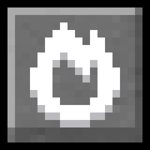
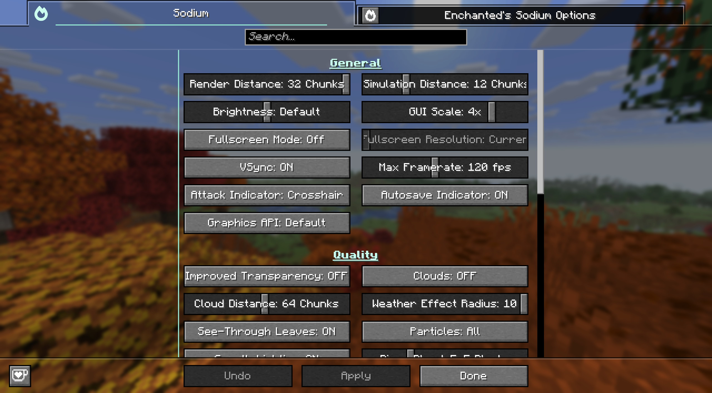
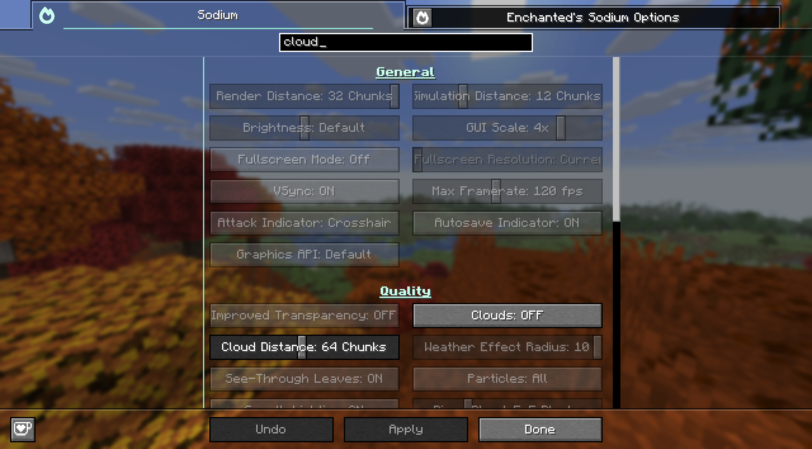
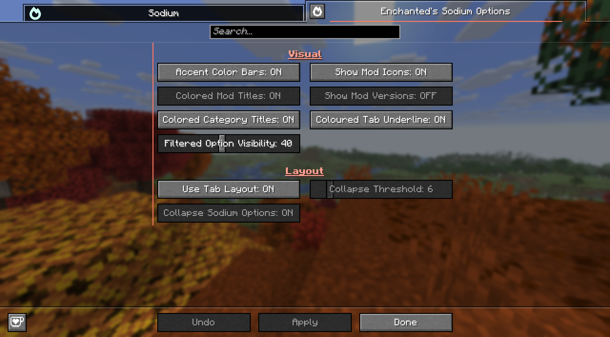
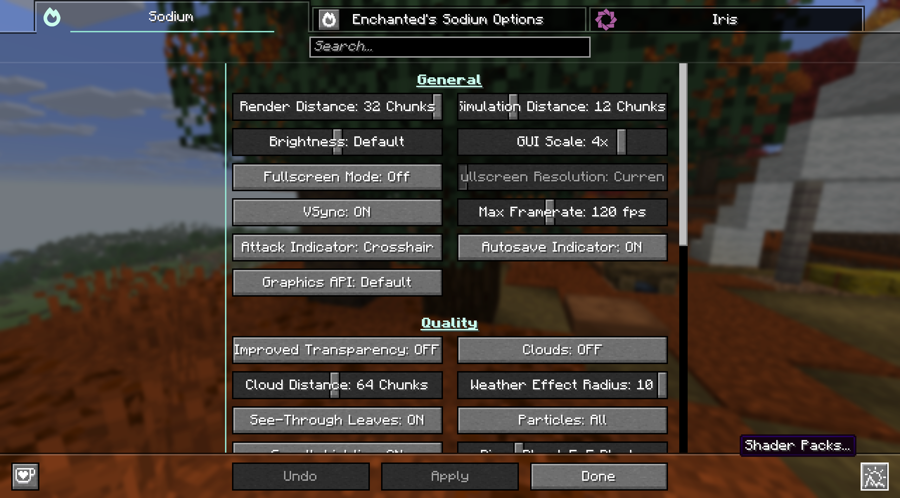
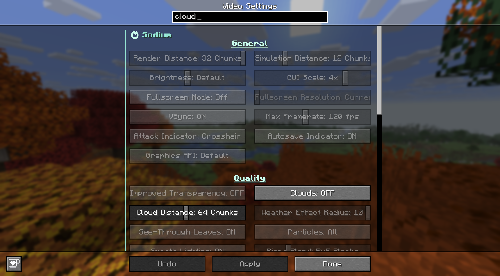

# Enchanted's Sodium Options

Enchanted's Sodium Options replaces Sodium's video settings screen with one that matches the aesthetic of vanilla Minecraft more closely.

  
More images...

  
  Enchanted's Sodium Options tab
  

  
  When Iris is installed, a shaderpacks button will appear in the bottom right to quickly access the shaderpacks screen
  

  
  Search with the column layout
    

## Features
- Supports all mods that appear in Sodium's config screen by default
- A search bar to help you find that one setting quickly (as of v1.4)
- Colours in the video settings screen can be disabled
- Alt + P keybind to open the default Sodium video settings screen if needed

## Supported Versions
- I will keep this mod updated to the latest version of Sodium
- This mod will not be backported to previous versions of Minecraft or Sodium due to Sodium lacking a proper config api in versions before `0.8`. The only exception to this is Sodium v0.8.13 on 1.21.1, I will likely port the mod to this version
- Forks of Sodium won't be supported by this mod

## Translations
- This mod has been translated to some languages, [See full list and credits here!](https://github.com/Enchanted-Games/enchanteds-sodium-options/blob/meta/TRANSLATORS.md)

## License

Enchanted's Sodium Options by <a rel="cc:attributionURL dct:creator" property="cc:attributionName" href="https://enchanted.games">ioblackshaw (a.k.a. Enchanted_Games)</a> is licensed under <a href="http://creativecommons.org/licenses/by-nc/4.0/?ref=chooser-v1" target="_blank" rel="license noopener noreferrer" style="display:inline-block;">CC BY-NC 4.0</a>
 
Video content creators may monetise videos including this work provided the license is followed.
